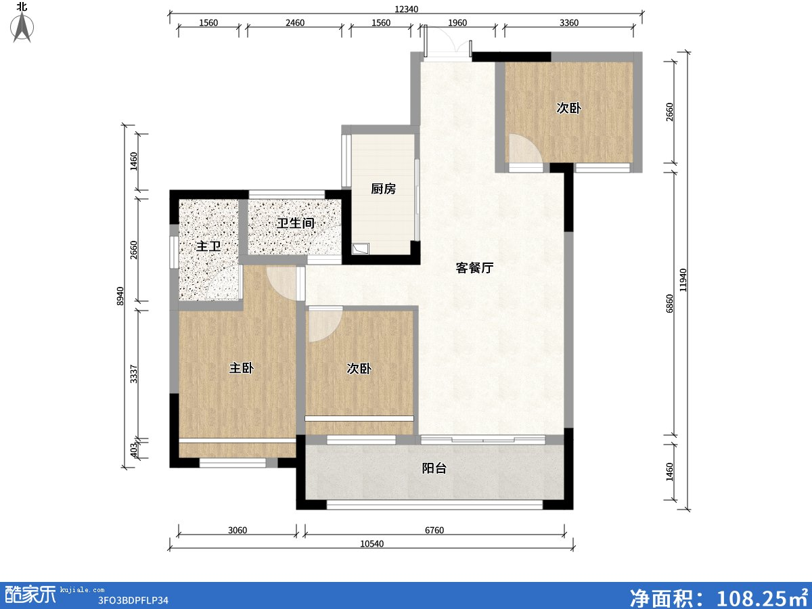
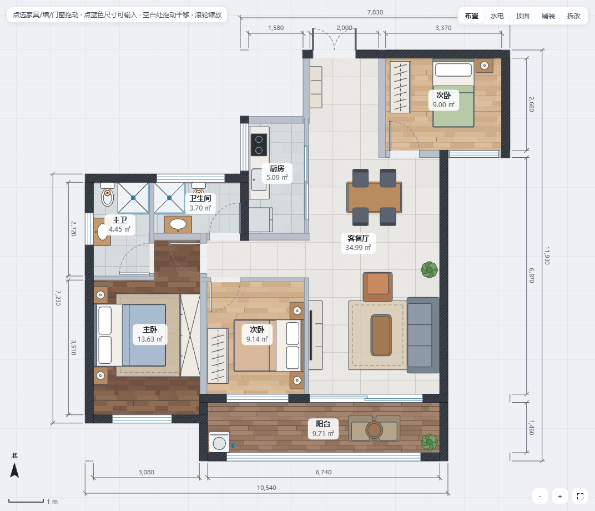
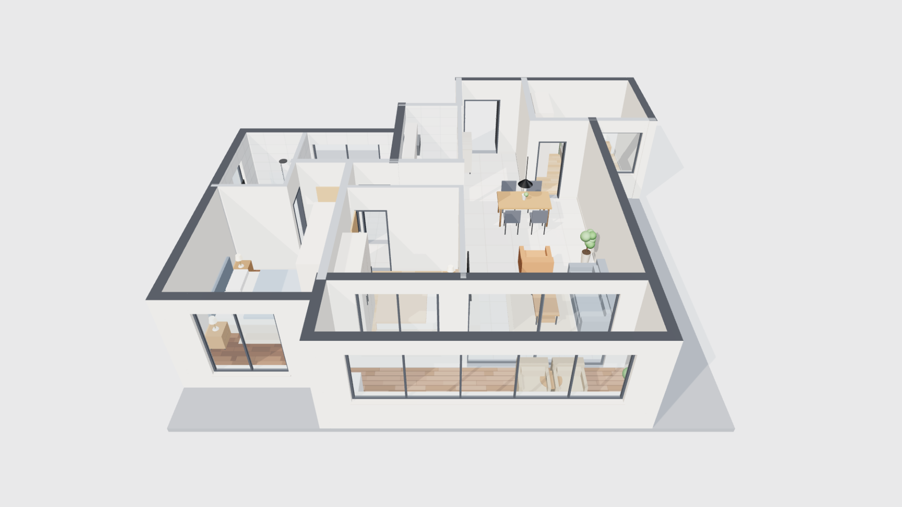
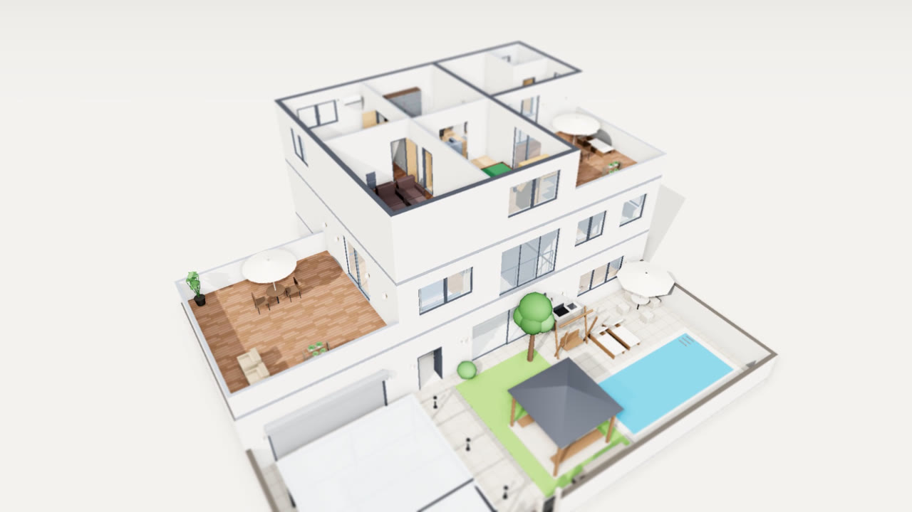
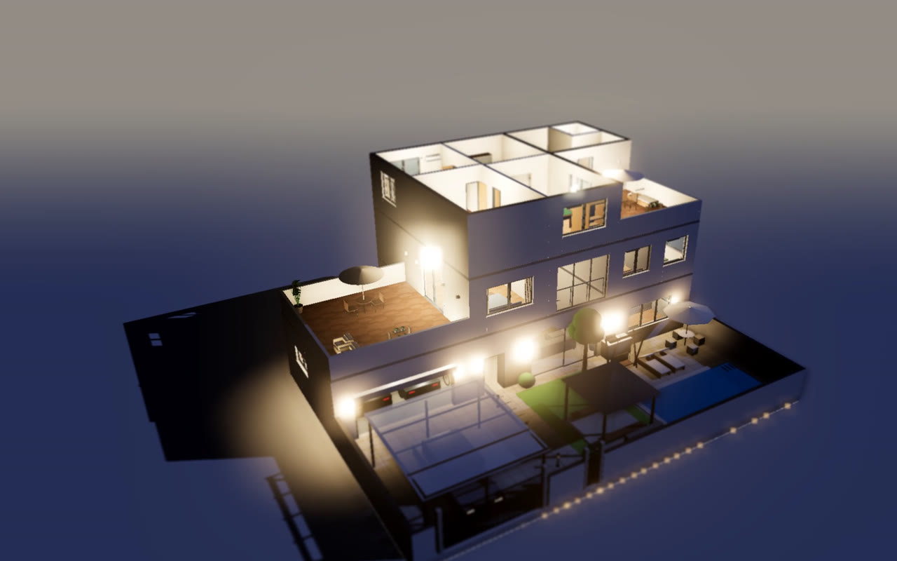
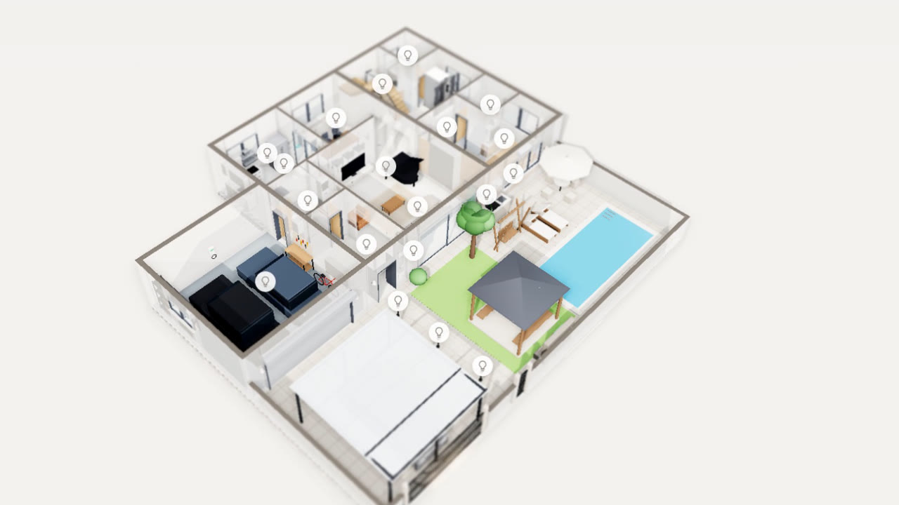
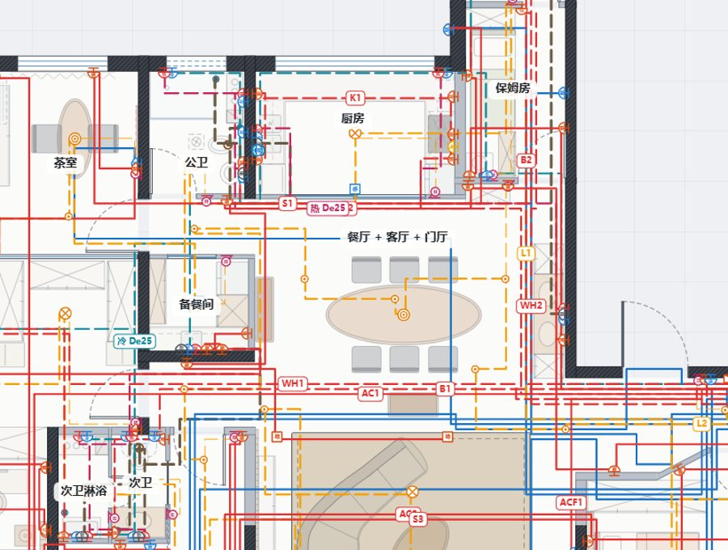
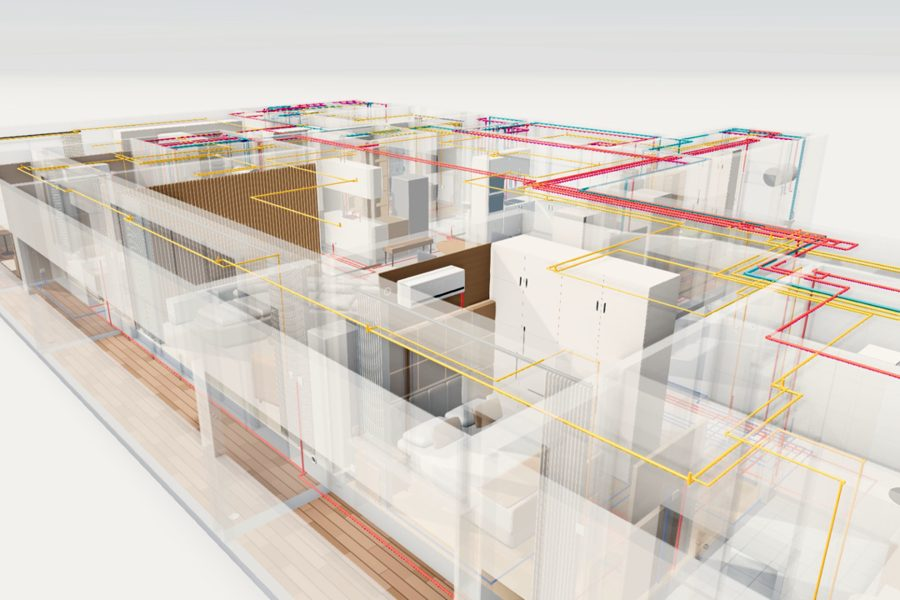
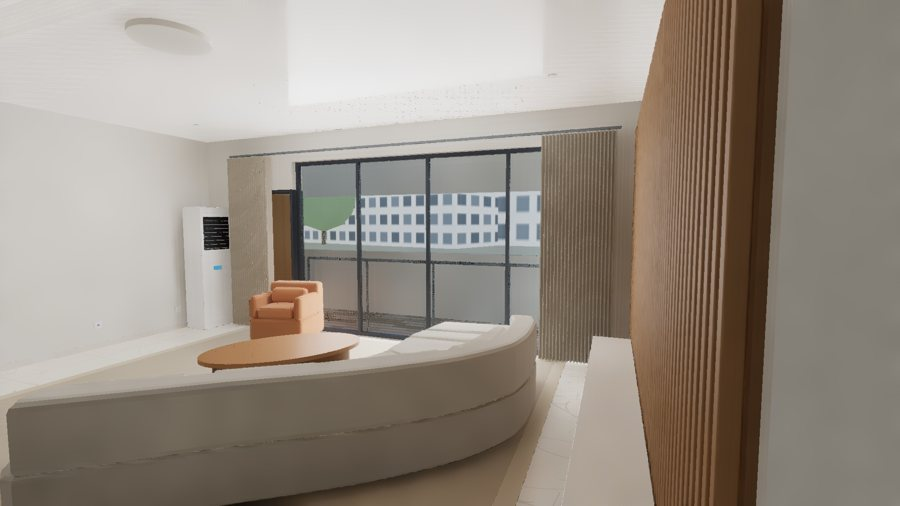
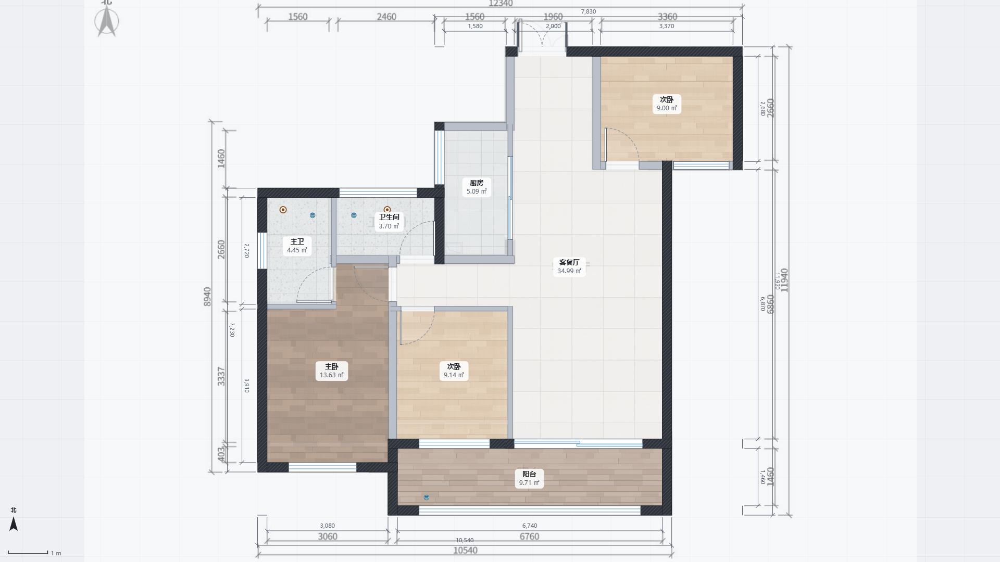

# 户型图设计器 Skill

**一张户型图（或一份 CAD 图纸），一句话，Agent 就把它还原成可 2D / 3D 直接设计的装修设计器网页。**

把户型图交给 Agent，它会自动量墙、看懂图纸、补全门窗和房间、摆好家具和水电，最后交给你一个**双击就能打开的单文件 HTML**。
打开就是你的户型：2D 布置、3D 漫游、定制家具、水电 / 吊顶 / 铺装 / 拆改、算量报价、整套施工图，还能**导出符合国标的 CAD 图纸（DXF）**；
插座、照明、网线、冷热水、排水**每一根线、每一根管自动排好**，5 类管线分开看、分开导出；写实建模和**光线追踪出图**。

适用于任何支持 Skill 的 Agent（Claude Code 等）。

| 输入：一张户型图 | 输出：设计器里的 2D 布置 | 同一份数据的 3D 鸟瞰 |
|:---:|:---:|:---:|
|  |  |  |

| 独栋别墅 · 沙盘效果图 | 晚上一键开灯，三层一起亮 | 智能中控：分层查看，设备图标浮在 3D 上 |
|:---:|:---:|:---:|
|  |  |  |

| 水电管线自动排布（2D） | 3D 管线透视：按真实高度走地 / 走顶 | 光线追踪出图 |
|:---:|:---:|:---:|
|  |  |  |

## 目录

- [用法](#用法)
- [能读哪些图](#能读哪些图)
- [它是怎么做到的](#它是怎么做到的)
- [生成的设计器能做什么](#生成的设计器能做什么)
- [水电管线自动排布](#水电管线自动排布)
- [写实建模与光线追踪](#写实建模与光线追踪)
- [导出 CAD 图纸（DXF）](#导出-cad-图纸dxf)
- [实测](#实测)
- [安装](#安装)
- [仓库结构](#仓库结构)
- [整栋楼（多楼层）与楼梯](#整栋楼多楼层)
- [独栋别墅](#独栋别墅)
- [交付验收：每个功能都实际点一遍](#交付验收每个功能都实际点一遍)
- [适用范围与局限](#适用范围与局限)
- [更新记录](#更新记录)
- [开发：更新设计器模板](#开发更新设计器模板)

## 用法

对你的 Agent 说：

```
把这张户型图做成装修设计器网页
```

再附上户型图（图片、截图、PDF、DXF 都行）。Agent 会按 [`SKILL.md`](SKILL.md) 的流程工作，最后在图片旁边生成 `<户型名>-装修设计器.html`，并附上 2D、3D 截图和识别说明（哪些尺寸按标注、哪些按图形量、图纸自己哪里前后矛盾）。

可以顺带提要求，Agent 会写进方案里：

```
客厅铺 800×800 灰色大板，主卧人字拼木地板；风格要奶油风；城市是杭州
厨房做 L 形橱柜，水槽在窗下；主卧衣柜做到顶
```

## 能读哪些图

| 输入 | 识别路线 | 精度 |
|---|---|---|
| 彩色户型图（酷家乐、贝壳、房天下、售楼处）、手绘带尺寸的平面图 | `scripts/analyze.py` 用 OpenCV 提取墙体 + 按尺寸标注定比例 | 按标注逐段定位，通常 ≤ 10 mm |
| 黑底 CAD 截图、扫描件、只有位图的 PDF | 同上，深色背景自动反相；墙只画双线（不填充）时 Agent 按标注手写墙 | 按标注 |
| **CAD 导出的矢量 PDF、DXF**（原始结构图、建筑平面图、拆改图，含黑底打印） | `scripts/cadvec.py` 直接读图元坐标，不经过像素 | 墙厚、墙段、洞口和标注数字一致（≤ 1 mm） |
| **整栋楼**：一页并排好几层平面（别墅、自建房、联排），或描边墙在交接处全断开的量房图（PDF / SVG / DXF） | `scripts/cadsplit.py` 按楼层切开、识别描边墙和门窗、各层自动对齐，输出整栋楼初稿 + 楼梯 / 电梯 / 开洞候选 | SVG / DXF 与标注一致；PDF 约 ±20 mm（受出图比例限制） |
| **位图里并排几层**（截图、照片，每层比例可以不同）、挑高复式 / LOFT | 每层按自己的分段尺寸定比例，各层相同的尺寸链对齐到同一坐标系；`scripts/gridmm.py` 给每层叠毫米网格逐块读 | 按标注 |
| DWG | 请先另存为 DXF，或用看图软件导出 SVG / 打印成 PDF | — |

CAD 路线按国标 GB/T 50001 / 50104 和装修图惯例理解画法：涂黑 = 钢筋混凝土 / 承重，砖纹填充 = 新砌墙，两条线 = 隔墙，3~4 条平行线 = 窗，开启弧线 = 平开门（弧心定门轴、弧侧定开向），错开两扇 = 推拉门，空断口 = 门洞，彩色框 = 新开洞口，⊠ = 烟道 / 管井，⊕ = 地漏，45° 斜杠 = 尺寸起止符号。
DXF 还按图层名（WALL / 墙、WINDOW / 窗、DOOR / 门、AXIS / 轴、DIM / 尺寸；家具、洁具、图框、标题栏层排除）、门窗编号（M0921、C1515）、房间名文字、DIMENSION 标注对象识别，中文 `\U+XXXX` 转义也能读。详见 [`reference/cad-conventions.md`](reference/cad-conventions.md)。

**尺寸以标注为准**：图上有尺寸标注时，cadvec 读出每段标注数字（没有文字层也能读：同一张图同一个数字字形完全一样，按字形聚类再用长度投票“破译”），把所有标注当成刻度间距约束做加权最小二乘，墙面、洞口边吸到对应刻度。图纸自身前后矛盾的标注（分段加起来 ≠ 总尺寸等）会逐条列出。

## 它是怎么做到的

1. **量墙**：矢量图纸用 `cadvec.py` 直接读坐标；图片用 `analyze.py` 提取墙体（承重 / 非承重按墙芯颜色聚类，分不开时按厚度猜并标出待确认），找出尺寸线刻度，配合 `axismap.py` 按标注数字把像素换成毫米。
2. **看懂图纸**：Agent 对照原图和带像素标尺的识别图，补全漏掉的墙（被窗打断的墙、很细的隔墙、只画双线的墙），分清门窗类型和开向，认出每个房间，写出户型描述 JSON（格式见 [`reference/spec-format.md`](reference/spec-format.md)）。
3. **自己检查**：`build.py` 生成网页，`check.mjs` 用无头浏览器打开，检查房间是否闭合、有没有悬空的墙、门窗是否被丢掉，算出外围三道尺寸和每个房间的开间 × 进深和图上标注逐个对数，并把生成结果半透明叠回原图截图。不对就改，循环到墙墙重合。交付前再用 `qa.mjs` 把设计器的每个功能实际操作一遍（见[交付验收](#交付验收每个功能都实际点一遍)）。
4. **自动布置**：按房间功能摆好家具和家电，放上地漏和下水口；户型描述写 `"autoElec": true`，设计器自动布好全套水电并把开关关联到灯，再跑一遍方案检查（重叠、挡门、通道宽度、马桶坑距……）。



## 生成的设计器能做什么

**户型与结构**
- 画墙、拆墙、改门窗，面积实时重算；墙体转角 / 丁字口按相交墙厚度精确接合，房间面积按墙面精确计算
- 外围三道尺寸、每段墙净长、房间开间 × 进深，改墙后实时重算；左侧可显示原图底图对照
- 门窗 12 种：单开、双开、子母、推拉、折叠、隐形推拉门、门洞；平开、推拉、落地（带护栏）、高窗、飘窗
- 薄墙在直线上接厚墙（隔墙接承重墙、外墙段变薄）时自动让墙面齐平，不会两边各错开半个厚度差；露台女儿墙、楼梯栏板只砌到栏板高

**家具与定制**
- 家具家电库 180 件：各种床、沙发（U 形 / 弧形 / L 形）、餐桌卡座、酒柜展示柜、卫浴洁具、空调热水器油烟机洗碗机、窗帘绿植、健身宠物用品，别墅用的车、充电桩、车棚、泳池、凉亭、台球桌、茶台、桑拿……
- **定制家具参数化**（现实里能定做的都能改，冰箱洗衣机等成品家电保持标准尺寸）：
  - 橱柜：一字 / L / U 形、地柜进深、台面高度厚度颜色、水槽和灶台在哪一段的哪个位置和宽度、单双盆、灶眼数、吊柜（高 / 深 / 离地）、油烟机、电器高柜；水槽灶台间距、灶台离墙不足时提示
  - 定制柜：每列宽度和类型（门板 / 抽屉 / 开放格 / 挂衣 / 玻璃门 / 中空 / 上门下抽）、L 形转角柜、顶柜、踢脚、拉手、平开 / 推拉门、一键顶天立地
  - 浴室柜单双盆 / 悬空 / 镜柜，淋浴房方形 / 钻石形 / 弧扇形 / 一字形，中岛水槽 / 灶台 / 吧台出挑
  - 2D、3D、立面图、报价（橱柜按延米、高柜按投影面积）、自动水电点位全部同步

**3D 与效果**
- 2D 平面、3D 鸟瞰、第一人称漫游、720° 全景；🔒 锁定防误触
- 写实建模（不用外部 glb 模型，全部程序生成）：乳胶漆 / 木纹 / 布纹 / 地板细微纹理和凹凸、鼓包软垫带包边、被子褶皱、家具小倒角；漫游有接触阴影、窗户面光源（拉上窗帘房间变暗）、房间反弹光、窗外城市远景，顶面不漏光；**光线追踪出图**；画质三档（见[写实建模与光线追踪](#写实建模与光线追踪)）
- 3D 可交互：点墙上的开关开关它关联的灯（双控、调光、三开分路），门能开关、平开窗 / 推拉窗能打开、窗帘能拉、电视能开、台灯能点亮；漫游时门窗窗帘和灯会真实改变室内光影
- 动效平滑：门窗、窗帘（一褶一褶收拢）、灯光淡入淡出、电视、楼层切换都用临界阻尼弹簧推进，起停都缓、中途反向不顿
- **智能中控**（3D 视图「🏠 智能中控」，参考 HAbridge 智能家居仪表盘，单层套房和多层都能用）：白色半透明墙、开灯在地面打出光池；问候 / 日期农历 / 日出日落、灯光空调窗帘开启数、室内环境曲线（模拟）；楼层切换和 ALL 爆炸视图；灯光 / 环境 / 设备 / 扫地机 / 安防五类设备图标浮在 3D 上，点开控制卡片——灯的色温亮度和场景、窗帘开合百分比、空调温度模式风速摆风（3D 出风气流）、设备开关、扫地机器人（栅格避障不穿模、关门进不去、受阻绕行、低电量回充充满续扫，留下清扫轨迹；没放基站时自动放一个虚拟的）、门窗开关和门锁；切换楼层时别的层滑开淡出，挑高层娃娃屋剖切。
  中控是 3D 里的模拟演示（环境数据为模拟、状态不存进方案、不连接真实设备），用途是装修前的预演：灯放哪、空调窗帘怎么配、扫地机能不能扫到每个角落，住进去之前先用一遍
- 真实日照：按城市纬度、月份、时间算太阳位置，晚霞星空月光，一键日照演示
- 视觉风格：写实 / 彩平图（正上方俯视，一键导出 4000 像素高清 PNG）/ 沙盘效果图（微缩模型感），方案原色 + 12 套主题配色

**装修设计**
- 布置 / 水电 / 顶面 / 铺装 / 拆改五种图层；墙顶地材质、吊顶、踢脚线、立面图
- 自定义铺砖：砖的长宽、灰缝、8 种铺法、6 种纹理、起铺点，一块块铺，报价按整砖 + 切砖片数算
- 独栋别墅：车库（电动卷帘门、车、充电桩、储物架）、庭院（围墙 + 车道口、大门、草坪、汀步、泳池、凉亭、车棚、乔木、草坪灯、烧烤台、景墙）、挑空客厅 + 水晶吊灯、电梯、茶室 / 影音室 / 台球室 / 桑拿、设备间（壁挂炉、分集水器、软水机）；一键水电会按车库、庭院、分层配电的规则布
- 智能中控：每盏主灯、吊灯单独一个图标，同房间的筒灯 / 壁灯 / 一排吸顶灯合成一组，2D 里加删灯、挪家具、改门窗都会自动同步
- **水电管线自动排布**：插座 / 照明回路、网线、冷热水、排水的每一根线和管，回路表、材料清单，5 类分开看、分开导出（见[水电管线自动排布](#水电管线自动排布)）
- 水电点位 29 种，一键布置水电（按功能区布灯：餐桌 / 岛台吊灯、沙发区、厨房操作区、玄关走廊，再全屋覆盖检查补筒灯不留暗区；门边开关、多门口和楼梯双控、床头双控；插座沿墙补齐、每间网口、电视位；橱柜冷热水、排水、燃气、空调孔、强弱电箱）
- 方案检查：家具重叠、挡门、通道太窄、马桶离下水口太远、家电附近缺插座或水点、吊柜挡窗、楼梯着地端 / 到达端 / 头顶净高等
- 自动算量报价；导出整套 A3 施工图 PDF、**CAD 图纸 DXF**、彩平图 PNG、分享文件；多方案管理与对比，自动保存

## 水电管线自动排布

水电图层在点位之上自动排出每一根线、每一根管（100 mm 网格 A* 寻路，只走横平竖直，少拐弯，优先从门洞过墙，尽量不穿承重墙，同类管线并排成束）。规则和依据见 [`reference/mep-rules.md`](reference/mep-rules.md)：

| 系统 | 怎么排 |
|---|---|
| 强电插座 | 按房间分回路（每路 ≤ 12 个点），厨房、卫生间、空调、电热水器、充电桩各自独立回路；断路器、线径按 GB 50096（插座回路 30 mA 漏保，进户 ≥ 10 mm²）；默认走地，可切走顶；厨卫回路一律走顶 |
| 照明 | 每路 ≤ 16 盏，固定走顶，开关线接到它控制的最近一盏灯 |
| 网线 | 弱电箱到每个网口 / 电视口各拉一根，不和强电平行贴着走（300 mm 内只垂直交叉） |
| 冷热水 | 从进户总阀、热水器出发树状接到每个用水点，干管 PPR De25、支管 De20；默认走顶（漏水好查），可切走地 |
| 排水 | 墙排、地漏接同一房间的立管 / 下水口，PVC De50、2.6% 坡度（GB 50015），离立管太远会提示起点要垫高多少 |
| 别墅 / 复式 | 总箱在入户层，其他层分层配电箱（自动算干线）；给水、热水立管从入户层接上来；挑空、楼梯井上不走地面管线；首层排水直接出户 |

- 6 个视图：全部 / 强电 / 照明 / 网线 / 给水 / 排水，单独看一类时只显示这一类的点位和图例
- 导出：当前视图 PNG / DXF；「5 类管线分别导出 CAD」一次出 5 份 DXF（按系统分图层 MEP-POWER / LIGHT / WEAK / COLD / HOT / DRAIN）；整套 PDF 每类一页；回路表 + 材料清单 CSV（BV 线按三色 × 1.1 损耗、线管、底盒、网线、PPR、弯头三通、PVC）
- 修改：点中一段管线拖动平移（保持横平竖直，首尾自动加拐点），「恢复自动走线」撤回；选中插座 / 灯可以改它所属的回路
- 3D「⚡ 管线」：管线按真实高度放进模型（走地贴地、走顶贴顶棚，到点位竖直上下墙），墙变半透明

管线排布是按国标常用做法自动生成的方案，用于装修前规划和沟通；正式施工前以现行规范原文和电工、设计师的核算为准。

## 写实建模与光线追踪

- **建模**：全部由代码程序生成（不依赖外部 glb）。软装是细分后“鼓起来”的填充感垫子，带包边；被子有褶皱；柜体、桌面有小倒角；墙面乳胶漆、木纹、布纹、地板都有世界坐标的细微纹理和凹凸，远处自动淡出不闪；布艺用丝绒光泽、烤漆用清漆层
- **漫游光影**：GTAO 接触阴影、窗户是面光源（窗帘拉上会暗）、房间光照探针模拟反弹光、窗外城市远景（夜里亮窗）、室内摄影调色、抗锯齿；墙段之间严丝合缝、不重叠，鸟瞰和漫游都不闪烁、不漏光
- **画质三档**：流畅 / 均衡 / 高画质，第一次打开按显卡自动选（核显 → 均衡，独显 → 高画质），在「🎨 风格 → 画质」里手动切换并记住
- **光线追踪出图**：☀ 面板「方式」选光线追踪（three-gpu-pathtracer + 自写的法线 / 深度 / 本色引导降噪），有进度条和剩余时间，可以随时“提前结束并保存”。实测 1920×1080、512 采样在 Intel UHD 630 核显上约 3 分 40 秒（含首次约 1~1.5 分钟的着色器编译）

## 导出 CAD 图纸（DXF）

设计器「导出图纸」菜单里有三种 DXF：**平面布置图（国标三道尺寸）**、**平面布置图（装修四道尺寸）**、**水电点位图**。
AutoCAD、天正、中望、浩辰和常见看图软件都能直接打开；按 GB/T 50001-2017《房屋建筑制图统一标准》/ GB/T 50104《建筑制图标准》的出图习惯组织：

| 项目 | 做法 |
|---|---|
| 格式 | DXF R2007（AC1021），文字 UTF-8，中文不乱码；模型空间 1:1，单位 mm |
| 图幅 / 比例 | 自动选（优先 1:100，A3 放不下换 A2 再降比例），图框（装订边 25）+ 标题栏 |
| 图层 / 线宽 | 墙、柱、门、窗、家具、水电、轴线、轴号、尺寸、文字、图框分层；线宽组 b = 0.5：墙柱 0.5、门窗 0.25、家具尺寸 0.13 |
| 图例 | 承重墙涂黑、新砌墙 45° 斜线（ANSI31）、拆除墙虚线；平面门开启线细实线 |
| 尺寸 | 国标三道（门窗洞口 / 轴线 / 总尺寸）或装修四道（多一道墙厚 + 净距）；第一道离外轮廓 10 mm、各道间距 10 mm；45° 建筑斜线；短段数字错开 + 引出线 |
| 标注对象 | 每段尺寸都是真正的 DIMENSION（标注样式 GB，DIMSCALE = 比例），数字由 CAD 按定义点量，和图形永远一致，可拖动编辑 |
| 轴线 | 承重墙 / 厚墙和柱的中线，单点长画线；轴号圆 8 mm，横向 1、2、3…，竖向 A、B、C…（不用 I、O、Z） |
| 门窗 | 编号 M / TLM / DK / C / GC / TC + 洞口宽高（分米），同类型同尺寸同窗台高才同号，撞号加 a、b；门窗表写毫米实数、数量、窗台高 |
| 水电点位图 | 单独一张（平面布置图不含点位），图例列出符号、名称、数量、安装高度 |
| 对象组织 | 每段墙、每樘门窗、每根柱是编组（点一下选中整组）；每件家具是图块（同款共用块定义） |
| 文字 | 字体 gbenor.shx + gbcbig.shx（宽度 0.7 ≈ 长仿宋），汉字 ≥ 3.5 mm、数字 ≥ 2.5 mm；房间名自动避开家具和门窗编号；指北针、图名 + 比例 |

导出的 DXF 可以再用 `cadvec.py` 读回来（实测墙体、门窗全部一致）。说明：DXF 存不了天正那种参数化“墙对象”，在 CAD 里拉一段墙不会带动相接的墙——要改墙回设计器里改，再导出。

## 实测

| 案例 | 输入 | 结果 |
|---|---|---|
| 三室两卫 12340 × 11940（上面那张图） | 彩色户型图 | 按宽 / 按深比例 17.65 / 17.61 mm/px；21 面墙（8 面由 Agent 补全）、8 门 7 窗、8 个房间全部识别；外轮廓误差 10 mm |
| 装修公司原始结构图 | 矢量 PDF（字体炸成轮廓） | 101 段标注读出 100 段，94 段与设计器尺寸差 ≤ 1 mm，其余 6 段是图纸自身矛盾；墙厚和标注一致 |
| 天正 DXF（图层、门弧、填充、标注） | DXF | 往返 16 / 16 个洞口，墙体 0 误差 |
| 设计器导出的 DXF 再读回 | DXF R2007 | 34 / 34 面墙、16 / 16 个门窗，71 段标注对象读回 69 段 |
| 二层平面图、四室两卫 | 黑底 CAD 截图（墙为双线） | 按标注逐段写墙，外围四道总尺寸和分段与标注一致；图纸自身前后矛盾的标注逐条列出 |
| 三层独栋别墅（车库 + 庭院） | 示例户型描述 `example-gen-villa.py` | 双车位车库 + 电动卷帘门、庭院围墙 + 车道口、车棚、泳池、凉亭、挑空客厅、U 形楼梯 + 电梯全部建出；一键水电三层分别 40 / 19 / 17 盏灯，晚上一键开灯三层同时亮；智能中控每层一台扫地机，各扫各的 |
| 挑高复式（一张图左一层右二层，两层比例不同） | 装修平面图截图 | 两层按相同尺寸链对齐；数出 30 级踏步 → 一层挑高 4.98 m、四跑三拐角楼梯（三处扇形转角踏步），两层平面与原图一致；漫游从起步走到二层过厅、从梯段底下进主卧门全部走通 |

完整示例：[`reference/example-spec.json`](reference/example-spec.json)（户型描述）、[`reference/example-gen.py`](reference/example-gen.py)（图片路线生成脚本）、[`reference/example-gen-precise.py`](reference/example-gen-precise.py)（按标注精确定位）、[`reference/example-gen-cad.py`](reference/example-gen-cad.py)（CAD 路线：读入 draft.json 再补改）、[`reference/example-gen-building.py`](reference/example-gen-building.py)（整栋楼）、[`reference/example-gen-duplex.py`](reference/example-gen-duplex.py)（挑高复式、多跑楼梯）、[`reference/example-gen-villa.py`](reference/example-gen-villa.py)（三层独栋别墅：车库、庭院、泳池、挑空、电梯）+ [`reference/example-walk-route.json`](reference/example-walk-route.json)（漫游走查路线）。

## 安装

1. 把本仓库放进你的 Agent 的 skills 目录，例如 Claude Code：

   ```bash
   git clone https://github.com/ZWD11/house-plan-designer ~/.claude/skills/house-plan-designer
   ```

   其他 Agent 放到各自约定的 skills 目录即可。

2. 安装依赖：

   ```bash
   pip install numpy pillow opencv-python pymupdf ezdxf   # 后两个给 CAD 图纸（PDF / DXF）用
   cd scripts && npm install                              # puppeteer-core，自查截图用
   ```

3. 本机需要有 Chrome 或 Edge（自查截图要用）。找不到时，设置环境变量 `CHROME_PATH` 指向浏览器程序。
   无头 3D 的显卡后端按平台选：Windows 用 D3D11，macOS 用 Metal，Linux 有显卡用 Vulkan 或 OpenGL，没有就用 SwiftShader。要改的话设置 `CHROME_ANGLE`，或给 `qa.mjs` 加 `--angle=swiftshader` 这种参数。

## 仓库结构

```
SKILL.md                         Agent 读的流程说明
assets/template.html             设计器模板（单文件，three.js 已内联，约 1 MB）
scripts/analyze.py               图片识别墙体 → 比例 + 尺寸线刻度 + HouseSpec 初稿
scripts/axismap.py               按尺寸标注把像素换成毫米（逐段，不用整体比例）
scripts/cadvec.py                CAD 矢量 PDF / DXF 识别 → 按标注定坐标的 HouseSpec 初稿
scripts/cadsplit.py              整栋楼 / 描边墙：一页多层自动切分 + 识别 + 各层对齐 → building_draft.json
scripts/dimtext.py               没有文字层时破译尺寸数字（字形聚类 + 长度投票）
scripts/gridmm.py                给户型图任意一块叠毫米网格并放大，按毫米直接读位置（位图多楼层用）
scripts/build.py                 户型描述 JSON + 原图 → 设计器网页
scripts/check.mjs                无头浏览器自查：报告 + 2D / 叠图 / 3D 截图
scripts/chrome.mjs               无头 Chrome 按平台选 ANGLE 显卡后端（可用 CHROME_ANGLE / --angle= 覆盖）
scripts/walktest.mjs             漫游走查：按路线走一遍，验证楼梯、扶手、门
scripts/qa.mjs                   交付验收：按平台选显卡后端，把设计器每个功能实际操作一遍，出报告 + 截图
scripts/qa_files.py              检查 qa.mjs 导出的文件能否正常打开
scripts/qa_furniture.mjs         家具库逐件拍 3D，人工核对模型
scripts/wallfit.py               按原图量每面墙的两个墙面，核对墙中线和厚度
scripts/furnoverlay.py           把 spec 里的家具画回原图，逐件核对“家具一比一还原”
scripts/dev/                     开发回归工具：
  make_test_dxf.py               把确认无误的户型画成 DXF，再用 cadvec 识别回来
  compare.py                     识别结果和标准答案逐项比对
  dumprooms.mjs                  导出每个房间的精确面积和矩形拆分，和按标注手算的面积核对
  mk_dxf_template.py             生成设计器 DXF 导出用的骨架（图层 / 线型 / 标注样式）
  shot3d.mjs / birdshot.mjs      漫游 / 鸟瞰机位截图（birdshot 还量相机微动时的闪烁像素）
  ptshots.mjs / uitest.mjs       光线追踪出图回归
reference/mep-rules.md            管线排布规则与规范依据（回路、线径、管径、走线方式、导出）
reference/catalog-sizes.json     家具库尺寸表（自动从设计器同步）
reference/spec-format.md         户型描述格式（墙、门窗、房间、家具含定制参数、水电、铺砖、整栋楼与楼梯）
reference/cad-conventions.md     CAD 图纸画法、识别规则、核对清单、导出 DXF 的规则
reference/example-*              完整示例（example-gen-building.py = 整栋楼模板，example-gen-duplex.py = 挑高复式，example-gen-villa.py = 独栋别墅，example-gen-furnished.py = 照图一比一还原家具的大平层）
```

## 整栋楼（多楼层）

设计器支持任意层数：每层单独编辑，2D 各层平铺 / 单层，3D 整栋 / 平铺 / 单独看某一层（可含下层剖切），风格和配色对每种看法都生效；
楼板开洞（楼梯井、挑空、下沉区）、家用电梯；漫游时可以走楼梯、坐电梯上下楼；报价可以全楼汇总；撤销 / 重做跨楼层。
只有一层时和以前完全一样。户型描述格式见 `reference/spec-format.md`“整栋楼”。

**楼梯**
- 类型：U 形（双跑折返、三跑）、直跑、休息平台、**扇形转角踏步**（照图上的放射线分块，90° 拐角和 180° 掉头都行），可以拼成 L 形、多跑盘旋楼梯；直跑段可以指定踏步数
- **读图**：按国标楼梯平面画法理解——首层只画剖切面以下的着地段、45° 折断线、以上虚线；顶层透过洞口看到整部楼梯、只标“下”；洞口里的斜线是楼板开洞，拐角的放射线是转角踏步。
  先分清**着地端**（下层图的实线起点、“上”字）和**到达端**（上层图洞口边接上层地面、“下”字起点），再数踏步推算层高：16~19 级是普通层高，26~34 级是**挑高复式**，楼梯多跑盘旋、上一跑压在下一跑正上方，两层图看到的不是同一段梯子
- **2D 也按这个画**：本层被剖切的梯段画折断线、以上虚线；上层洞口里自动画出下层整部楼梯并标“下”
- **扶手**：外沿悬空的地方自动装；按高度判断有没有依靠（旁边是墙、或另一段梯段 / 平台高差在一步之内才算接上），上下叠着的两跑照样装；漫游时扶手、栏板、女儿墙都挡人，从高段梯段底下可以走过去、进出门
- **自动检查**：最低一级离地 ≤ 一级且踩在本层地面上；最高一级 = 楼面到楼面、外侧是上层地面；梯段头顶净空 < 2 m 的地方上层必须开洞
- `scripts/walktest.mjs` 按一条路线在漫游里把楼梯真走一遍（脚高、楼层、是否被挡），交付前验证用

## 独栋别墅

别墅图和公寓图的区别是主楼外面还有车库、庭院、车棚、泳池，楼里常有挑空客厅、电梯、设备间和露台。Agent 按 [`SKILL.md`](SKILL.md)“独栋别墅”一节认图：

- **车库**：外墙上 2.4~6 m 的大洞口 → 电动卷帘门（门型 `garage`，3D 里点一下卷起 / 放下），车库里放车、壁挂充电桩、储物架
- **庭院**：主楼外一圈围墙圈起来的地方，围墙按高度砌、车道口和人行门留通高洞口；草坪、汀步、乔木、草坪灯、烧烤台、景墙
- **车棚、泳池、凉亭**：照图上的位置和尺寸摆
- **挑空、电梯**：上层楼板开洞（挑空四周装栏板，可挂水晶大吊灯）；电梯每层同一位置，漫游时能坐电梯上下楼
- **水电**：车库按面积排灯、进屋门和车库门双控、每个车位一个充电桩电源、卷帘门电机插座；庭院 / 露台沿墙壁灯、防水插座、取水点

完整示例：[`reference/example-gen-villa.py`](reference/example-gen-villa.py)。

## 交付验收：每个功能都实际点一遍

`check.mjs` 管户型对不对，`qa.mjs` 管设计器每个功能能不能用、显示对不对。SKILL.md 规定**交付前必须全部通过**：

```bash
node scripts/qa.mjs <设计器.html> <输出目录>            # 约 20 分钟；--quick 跳过 PDF 和光线追踪（约 8 分钟）；--angle= 改显卡后端
python scripts/qa_files.py <输出目录>/downloads        # 导出的 PNG / DXF / PDF / CSV / JSON / 分享文件能不能正常打开
node scripts/qa_furniture.mjs <设计器.html> <输出目录>  # 改家具建模时：全部家具排成网格分块拍 3D，逐件看
```

- 用无头 Chrome 打开设计器（Windows 用 D3D11，macOS 用 Metal，Linux 有显卡用 Vulkan / OpenGL，没有就用 SwiftShader；`CHROME_ANGLE` 或 `--angle=` 可改），把 2D 编辑（画墙、房间、门窗、点位、批注、测量、拆墙、家具拖动旋转复制删除、撤销重做）、属性面板（墙、门窗、房间、点位、定制橱柜 / 柜体）、5 个图层、水电 6 个视图和拖动改线、全部导出、报价、方案管理与对比、楼层、保存后刷新、3D 风格 / 配色 / 画质 / 日照 / 漫游 / 全景 / 光线追踪 / 智能中控 5 类设备，以及 4 种电脑屏幕尺寸和手机尺寸，一项项实际操作
- 判失败：页面报错、界面出现 NaN / undefined、操作后状态没变、导出没下载到或打不开、3D 画面空白、按钮被挤出或重叠、夜里中控文字对比度不够、手机上平面超出屏幕
- 输出 `report.md`（每项 ✅ / ❌ + 原因 + 截图）和每一步的截图，自动检查之外再人工过一遍截图
- 示例户型实测：大平层四室 110 / 110、三层独栋别墅 112 / 112，导出文件 24 / 24 正常

## 适用范围与局限

- 最适合**带尺寸标注**的图：彩色户型图、CAD 矢量图纸效果最好；黑底截图、墙只画双线的图需要 Agent 按标注手写墙，多花几轮。
- 纯线稿、扫描件、拍歪的照片，自动识别的初稿会很差，主要靠 Agent 根据尺寸标注推算。
- 图上没有任何尺寸时，Agent 会问你要一个已知尺寸，或者按常见尺寸估算并注明。
- 承重墙：图片按颜色 / 厚度判断，CAD 按“涂黑 + 厚度”判断（原始结构图常把所有原墙涂黑），以物业结构图为准。
- 存档保存在浏览器本地；换电脑或发给别人时，用设计器里的“导出 → 分享文件”。
- 导出的 DXF 是标准 CAD 图元（线、填充、标注、编组、图块），不含天正自定义实体。

## 更新记录

- **2026-10-22**：**水电管线自动排布**（强电 / 照明回路、网线、冷热水、排水，参照 GB 50096 / 50311 / 50242 / 50015；回路表、材料清单；拖动改线；3D 管线透视；别墅分层配电和立管）；**5 类管线分开看、分开导出**（PNG / DXF / PDF 每类一页）；**写实建模**（软垫鼓包、被子褶皱、细微纹理凹凸、丝绒 / 清漆）和**漫游光影**（接触阴影、窗户面光源、反弹光、城市远景）；**光线追踪出图**；**画质三档**；新增 `qa.mjs` 全功能交付验收。修复：配色切换出现条纹、墙面闪烁和小白点、玻璃底边白点、房间名标签挡住墙和门窗点不中、日照演示后一直是夜景、夜里中控文字看不清、PDF 图签长图名溢出、手机上楼层条挡住按钮、窗口变窄平面跑出屏幕、餐桌模型自带吊灯与水电吊灯重复
- **2026-10-17**：**智能中控**（灯光 / 环境 / 设备 / 扫地机 / 安防，多层 ALL 爆炸视图和楼层切换，每层一台扫地机）；**独栋别墅**（车库电动卷帘门、庭院围墙、车棚、泳池、凉亭、挑空、电梯，别墅家具 30 多件）；**一键水电重写**（按功能区布灯，全屋覆盖检查补筒灯，插座沿墙补齐）；门窗、窗帘、灯光、楼层切换改成弹簧动效；晚上一键开灯整栋所有楼层一起亮；修复床板闪烁、楼板多出一块、沙盘眩光、灯光卡片点不动
- **2026-10-15**：整栋楼 / 挑高复式与楼梯：多跑楼梯、扇形转角踏步、国标楼梯画法、扶手碰撞、楼梯两端检查
- **2026-10-12**：CAD 矢量识别、国标 DXF 导出、定制家具参数化
- **2026-10-09**：尺寸精确、自定义铺砖、彩平图、漫游室内光影；沙盘效果图与 12 套配色、真实日照与月夜、家具库扩到 130 件；家电门窗补齐、一键布置水电、3D 可交互

## 开发：更新设计器模板

设计器源码是一个 TypeScript + Vite + three.js 项目（不在本仓库）。改完功能后在项目里执行 `npm run skill:sync`：打包成单文件并复制到 `assets/template.html`。
读取预设户型的代码在项目的 `src/model/spec.ts`（`planFromSpec`、`window.__PRESET__`）和 `src/app.ts`；DXF 导出在 `src/export/dxf.ts`，其骨架由 `scripts/dev/mk_dxf_template.py` 生成。
